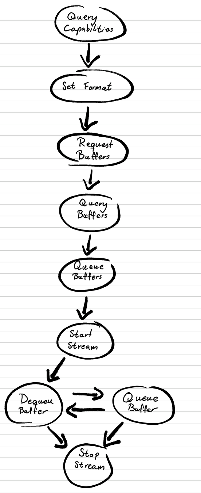

# Camera capture



Capturing from the camera is not simple. It follows the sequence shown above.

## Functions

These are the functions we have for it:

- `get_format()`
- `set_format()`
- `request_buffers()`
- `queue_buffer()`
- `dequeue_buffer()`
- `stream_on()`
- `stream_off()`

All of them work the same way underneath: they use the **V4L2 API** (Video4Linux2). V4L2 is the Linux kernel's interface for video devices such as cameras. The camera shows up as a device file (`/dev/videoN`), and we control it by sending commands to that file with **ioctl** (I/O control, a Linux system call).

## How ioctl works

We'll use `set_format()` as the example:

```python
def set_format(self, width, height, pixelformat):
    """Set video format"""
    fmt = bytearray(208)  # v4l2_format structure size
    struct.pack_into('I', fmt, 0, V4L2_BUF_TYPE_VIDEO_CAPTURE)
    struct.pack_into('I', fmt, 8, width)
    struct.pack_into('I', fmt, 12, height)
    struct.pack_into('I', fmt, 16, pixelformat)
    struct.pack_into('I', fmt, 20, V4L2_FIELD_NONE)

    fcntl.ioctl(self.fd, VIDIOC_S_FMT, fmt)

    # Read back actual values
    self.width = struct.unpack('I', fmt[8:12])[0]
    self.height = struct.unpack('I', fmt[12:16])[0]
    self.pixelformat = struct.unpack('I', fmt[16:20])[0]

    fmt_str = fourcc_to_string(self.pixelformat)
    print(f"Set format: {fmt_str} ({self.width}x{self.height})")
```

It packs all the settings into a byte array and then sends that array with ioctl.

### Decoding the call

```python
fcntl.ioctl(self.fd, VIDIOC_S_FMT, fmt)
```

| Argument | Meaning |
|---|---|
| `self.fd` | File descriptor of the open video device |
| `VIDIOC_S_FMT` | The request code for the "set format" command |
| `fmt` | The byte array holding all the settings we send |

### Decoding `VIDIOC_S_FMT`

```python
VIDIOC_S_FMT = _IOWR('V', 5, 208)
```

`_IOWR(type, nr, size)` builds the request code:

1. **`_IOWR`** means the data goes both ways: we write it in and the kernel writes it back. Similarly, `_IOR` is read-only and `_IOW` is write-only.
2. **`type`**: `'V'` is the letter shared by all V4L2 commands.
3. **`nr`**: the command number, which tells V4L2 commands apart. `5` means "set format".
4. **`size`**: the size of the data sent, here `struct v4l2_format`, which is 208 bytes.

The four fields are packed into a single 32-bit number:

| Field | Value | Shifted into place |
|---|---|---|
| direction (read + write) | `3` | `3 << 30` = `0xC0000000` |
| size | `208` | `208 << 16` = `0x00D00000` |
| type | `'V'` = `0x56` | `0x56 << 8` = `0x00005600` |
| nr | `5` | `0x00000005` |
| **`VIDIOC_S_FMT`** | | **`0xC0D05605`** |

You don't need to compute this yourself. It's just a constant defined by V4L2's rules, the same value the kernel's C headers use.

### After the call

`fcntl.ioctl(self.fd, VIDIOC_S_FMT, fmt)` sends the request to the Linux kernel. Because the call goes both ways, the kernel writes the values it actually used back into `fmt`, so we read them back to check them. Every command in the list above is defined this way.
